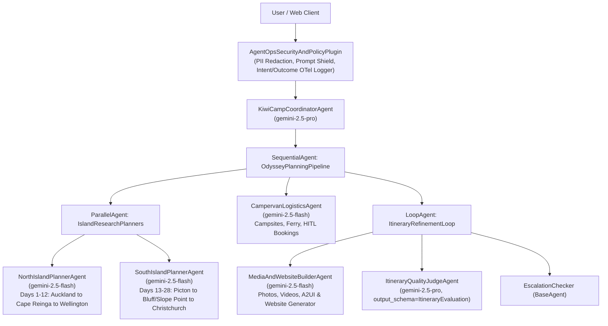

# DESIGN_SPEC.md — KiwiCamp: 4-Week New Zealand Campervan Odyssey Agent & Media-Rich Itinerary Website

## Overview

**KiwiCamp** is a production-grade multi-agent system built with the **Google Agent Development Kit (ADK)** and deployed on **Vertex AI Agent Runtime (`ReasoningEngine`)**. It solves the complex planning, logistics, and media curation problem of organizing a **4-week (28-day) self-drive campervan expedition across New Zealand's North and South Islands in December (austral summer)**:

1. **End-to-End Geographical Route**:
   - **Arrival**: Land in **Auckland**, pick up a self-contained campervan, and head north to the northernmost tip of the North Island (**Cape Reinga / Te Rerenga Wairua**).
   - **North Island Traverse (Days 1–12)**: Auckland → Whangarei & Bay of Islands → Cape Reinga & Ninety Mile Beach → Hokianga & Waipoua Kauri Forest → Coromandel Peninsula (Cathedral Cove, Hot Water Beach) → Hobbiton & Rotorua Geothermal Valley → Taupo & Huka Falls → Tongariro Alpine Crossing → Wellington (Te Papa, Cuba Street).
   - **Inter-Island Crossing (Day 13)**: Cook Strait Campervan Ferry from **Wellington to Picton** through the Marlborough Sounds.
   - **South Island Traverse to the Southern Tip & Back (Days 14–28)**: Picton & Marlborough → Nelson & Abel Tasman National Park → Punakaiki & West Coast → Franz Josef & Fox Glaciers → Haast Pass to Wanaka → Queenstown & Arrowtown → Te Anau & Milford Sound (Fiordland) → Invercargill, **Bluff & Slope Point (Southernmost Tip of the South Island)** & The Catlins → Dunedin & Otago Peninsula → Moeraki Boulders & Aoraki / Mount Cook → Lake Tekapo & Dark Sky Reserve → **Christchurch** campervan drop-off and international departure.
2. **Media-Rich Interactive Website Deliverable**:
   - Generates a modern, responsive, interactive single-page web application (`web/index.html`, `web/styles.css`, `web/app.js`, `web/itinerary_data.json`) alongside **A2UI v0.9** generative UI cards.
   - Every single day (Days 1–28) includes detailed narrative guides, must-see highlights, hidden gems, December summer weather & activity advisories, driving distance/duration, certified freedom-camping or DOC/Holiday Park overnight stops, high-resolution photography galleries, and embedded YouTube video tours.
3. **Full Alignment with the 95-Point AgentOps Code Review Matrix**:
   - Architected from the ground up to provide clear, verifiable code evidence for all **19 grading criteria (95/95 points)** across Tool & Interface Design, Context & Memory, Orchestration & Logic, Observability & Tracing, and Infrastructure & CI/CD.

---

## Example Use Cases

| Use Case | User Input | Expected Output |
| :--- | :--- | :--- |
| **1. Full 4-Week December Campervan Itinerary & Website Generation** | *"Plan a 4-week December campervan itinerary starting from the northern tip of the North Island to the southern tip of the South Island, landing in Auckland and departing from Christchurch, and build a media-rich interactive website with photos and videos for every day."* | Coordinates North & South Island planners in parallel, validates campervan drive times and DOC/holiday park sites, enriches all 28 days with photo galleries, YouTube video tours, and December weather notes, passes the quality loop, and outputs the structured 28-day JSON + interactive HTML/CSS/JS website. |
| **2. Interactive Day / Region Customization with Memory Recall** | *"Remember that I love sea kayaking and geothermal hot pools, and prefer freedom camping where legal. Update Days 7–9 and Days 14–15 to highlight those."* | Scrubs any PII from input, stores user preferences asynchronously in Vertex AI Memory Bank (`wait_for_completion=False`), recalls them via `PreloadMemoryTool`, and updates the Rotorua/Taupo and Abel Tasman segments. |
| **3. High-Stakes Booking with Human-in-the-Loop Confirmation** | *"Go ahead and reserve the Cook Strait campervan ferry for December 13 and book the Milford Sound Lodge powered campervan site for December 21."* | Triggers `require_confirmation` HITL hooks on `reserve_cook_strait_campervan_ferry` and `book_paid_holiday_park_site`, pausing execution and presenting cost, vehicle length, and cancellation terms for explicit user approval before executing. |

---

## Tools Required

All tools use strict **Pydantic v2 `BaseModel` input/output schemas**, comprehensive Google-style docstrings, specific action-oriented names, and **guided error handling** (returning actionable recovery instructions to the LLM on validation or transient failures):

1. `calculate_campervan_route_segment` — Computes driving distance (km), campervan-adjusted duration (hours), winding/alpine road warnings, and fuel/charging stops between two NZ locations.
2. `search_nz_holiday_parks_and_campsites` — Queries grounded NZ Department of Conservation (DOC), Top 10 Holiday Parks, and certified self-contained freedom camping sites by region, amenities, and December peak availability.
3. `check_december_weather_and_seasonal_hazards` — Returns December austral summer climate data (daylight hours, UV index, alpine pass conditions, sandfly advisories in Fiordland) for a specific NZ region.
4. `fetch_destination_media_gallery` — Retrieves curated, verified high-resolution photography URLs, captions, and public YouTube walkthrough/drone video embeds for each New Zealand landmark.
5. `generate_interactive_itinerary_website` — Compiles the validated 28-day itinerary, map coordinates, photo galleries, and video embeds into the standalone media-rich interactive web application (`web/`) and saves session artifacts via `ToolContext.save_artifact`.
6. `reserve_cook_strait_campervan_ferry` *(HITL `require_confirmation=True`)* — Books the Interislander / BlueBridge Cook Strait ferry for a campervan between Wellington and Picton; requires explicit human confirmation for bookings over threshold or non-refundable fares.
7. `book_paid_holiday_park_site` *(HITL `require_confirmation=conditional`)* — Reserves a powered campervan site at high-demand December holiday parks; pauses for human confirmation before charging.

---

## Constraints & Safety Rules

1. **Geographical & Temporal Fidelity**:
   - Must cover **all 28 days (4 weeks)** in **December**.
   - Must begin with arrival in **Auckland**, travel north to **Cape Reinga** (northernmost tip of the North Island), cross via ferry to the South Island, reach **Bluff / Slope Point** (southernmost tip of the South Island), and conclude with departure from **Christchurch**.
2. **Campervan Safety & Legal Compliance**:
   - Enforce a maximum daily driving limit of **4.5 hours (or 300 km)** on winding New Zealand roads; if a user or sub-agent proposes an unsafe single-day drive (e.g., Auckland to Wellington non-stop), the tool returns a guided error instructing the LLM to split the leg.
   - Freedom camping recommendations must require a **certified self-contained vehicle** (green warrant) and respect local council bylaws.
3. **PII Redaction & Prompt Security**:
   - All user inputs, logs, and memory writes pass through `PiiRedactionService` (combining regex scrubbers with optional Google Cloud DLP `google-cloud-dlp` inspection) to redact emails, phone numbers, driver's license/passport numbers, and payment cards.
   - `AgentOpsSecurityAndPolicyPlugin` inspects incoming prompts in `before_model_callback` to block prompt injection attempts.
4. **Human-in-the-Loop (HITL) Mandatory Stops**:
   - High-stakes financial or reservation tools (`reserve_cook_strait_campervan_ferry`, `book_paid_holiday_park_site`) must never execute autonomously without explicit human confirmation.
5. **Zero Hardcoded Secrets**:
   - No API keys or credentials in code; all secrets are fetched via `SecretManagerServiceClient` (`google-cloud-secret-manager`) with environment variable fallback for local tests.

---

## Architecture & Rubric Mapping (95/95 Points)

| Rubric Category | Criterion (5 pts each) | Implementation in Repository |
| :--- | :--- | :--- |
| **1. Tool & Interface Design (20 pts)** | Comprehensive Tool Docstrings | Full Google-style docstrings with purpose, `Args`, `Returns`, and recovery notes in `app/tools/nz_campervan_tools.py`. |
| | Descriptive Naming | Specific verbs: `calculate_campervan_route_segment`, `search_nz_holiday_parks_and_campsites`, `fetch_destination_media_gallery`, etc. |
| | Explicit JSON Schemas | Strict Pydantic v2 `BaseModel` schemas (`app/schemas/itinerary_schemas.py`) validating all tool inputs, outputs, and `output_schema`. |
| | Guided Error Handling | Structured error payloads (`status="error"`, `recovery_instructions="..."`) + `ReflectAndRetryToolPlugin`. |
| **2. Context & Memory (20 pts)** | Robust System Instructions | Constitutional system prompts (`app/prompts/constitution.py`) defining persona, NZ domain rules, and safety boundaries. |
| | History Compaction | `EventsCompactionConfig(compaction_interval=10, overlap_size=2, summarizer=LlmEventSummarizer(...))`, `ContextFilterPlugin`, and `ContextCacheConfig` in `app/agent.py`. |
| | Persistent Session State | `VertexAiSessionService` / `DatabaseSessionService` + `VertexAiSearchTool` grounding store in `app/memory/session_and_rag.py`. |
| | Async Memory Operations | Non-blocking `asyncio.create_task` + `VertexAiMemoryBankService` (`wait_for_completion=False`) in `app/memory/async_memory_bank.py`. |
| **3. Orchestration & Logic (20 pts)** | Multi-Agent Patterns | Coordinator (`KiwiCampCoordinatorAgent`) + `SequentialAgent` + `ParallelAgent` + `LoopAgent` + custom `BaseAgent` (`EscalationChecker`) + A2A exposure (`to_a2a`). |
| | Strategic Model Routing | `ModelRouter` assigning `gemini-2.5-flash` to high-speed retrieval/media sub-agents and `gemini-2.5-pro` to complex route planning & quality evaluation. |
| | Guardrails & Policy Plugins | `AgentOpsSecurityAndPolicyPlugin(BasePlugin)` + self-eval `ItineraryQualityJudgeAgent` + Model Armor hook (`app/plugins/security_guardrails.py`). |
| | Human-in-the-Loop Hooks | `FunctionTool(..., require_confirmation=...)` + `before_tool_callback` confirmation gate on ferry & campsite booking tools. |
| **4. Observability & Tracing (20 pts)** | Structured JSON Logging | `StructuredJsonFormatter` (`python-json-logger`) emitting structured JSON logs with trace/span correlation (`app/observability/telemetry.py`). |
| | Intent vs. Outcome Capture | Explicit `INTENT` log before model/tool execution and `OUTCOME` log after execution with latency & diff metadata in `AgentOpsSecurityAndPolicyPlugin`. |
| | Distributed Tracing | OpenTelemetry `TracerProvider`, `CloudTraceSpanExporter`, and custom spans linking user query → sub-agents → tool calls → website build. |
| | PII Redaction | Active PII scrubbing filter (`app/observability/pii_redactor.py`) using Google Cloud DLP API + deterministic regex fallback before logging or memory storage. |
| **5. Infrastructure & CI/CD (15 pts)** | Automated Evaluation Suites | Golden evaluation dataset (`tests/eval/evalsets/nz_campervan_golden.evalset.json`), `eval_config.json`, `pytest` unit/integration suite, and `agents-cli eval run`. |
| | Infrastructure as Code | Terraform (`deployment/terraform/*.tf`) for Vertex AI Agent Runtime, GCS, BigQuery, Secret Manager, IAM + `agents-cli` config & GitHub Actions (`.github/workflows/ci_cd.yml`). |
| | Secure Secret Management | `SecretManagerClient` (`app/utils/secrets.py`) fetching secrets from Google Cloud Secret Manager without hardcoded keys. |

---

## Success Criteria

1. **Rubric Completeness**: Passes static and dynamic verification for all **19 criteria (95/95 points)** in the AgentOps Code Review Matrix.
2. **Itinerary & Website Completeness**: Produces a complete 28-day December itinerary covering Auckland → Cape Reinga → Wellington → Picton → Bluff/Slope Point → Christchurch, rendered in a rich, self-contained interactive website (`web/index.html`) with photos, embedded videos, route map, and daily campervan logistics.
3. **Automated Tests & Evals**: All unit tests (`pytest`) and golden evaluation cases (`agents-cli eval run`) pass with zero hardcoded secrets.
